 

# Aditya Chebrolu

Computer vision, OCR and predictive maintenance 
SRM Institute of Science and Technology · Bengaluru, India

 

I like building models that make it out of the notebook and into something people can actually use.

 

---

### Now building

Client work from my internship. Source is under NDA.

 

  

### Selected work

 

 

---

### Experience

`2026` &nbsp; **Hindustan Aeronautics Limited** · Project Management Intern
`2026` &nbsp; **AeroReason** · Published research
`2025` &nbsp; **FAST × NVIDIA × SRM** · Founding Member
`2024` &nbsp; **Coratia Technologies** · Data Science Intern

### Stack

**AI / ML** &nbsp; PyTorch · XGBoost · scikit-learn · OCR / CV · NLP · TrOCR
**LLMs** &nbsp; LLaMA3 · Mistral
**Languages & frameworks** &nbsp; Python · JavaScript · React · FastAPI · Flask · Node.js · Flutter
**Data & hardware** &nbsp; MongoDB · SQL · NFC / MIFARE DESFire
**Tools** &nbsp; Git · SAP Analytics Cloud

---

[GitHub](https://github.com/adichebrolu21) &nbsp;·&nbsp; [LinkedIn](https://www.linkedin.com/in/aditya-chebrolu-5a0321277/) &nbsp;·&nbsp; [Email](mailto:adi.chebrolu21@gmail.com)

